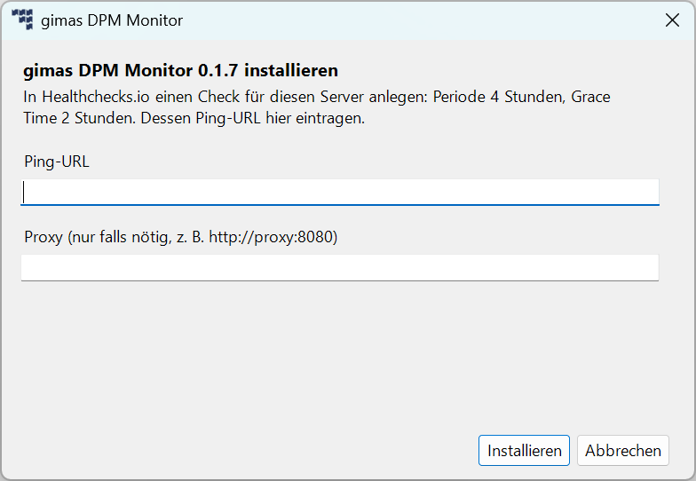
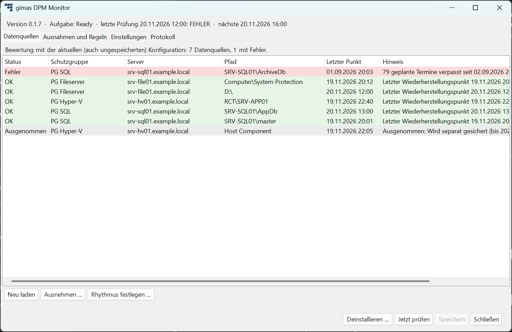
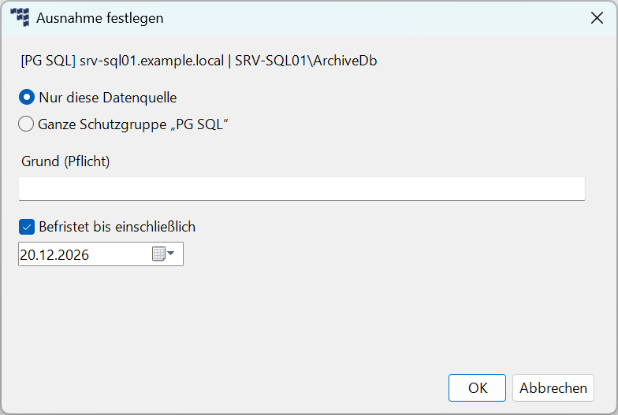
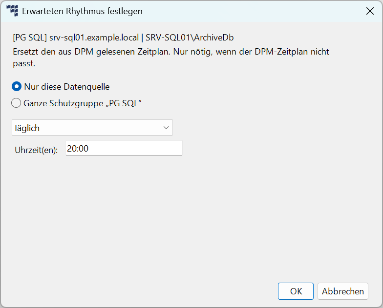

# dpm-monitor

Überwachung von Microsoft System Center Data Protection Manager (DPM) auf On-Premises-Servern,
entwickelt von der gimas GmbH für die DPM-Server ihrer Kunden.

> **Status:** Vorabversion (0.x) für den Pilotbetrieb. Getestet mit synthetischen Daten, in Windows Sandbox und
> gegen Healthchecks.io, aber noch nicht auf einem echten DPM-Server. Version 1.0 folgt nach dem Pilot.

## Was es tun soll

- Prüft regelmäßig auf dem DPM-Server, ob für jede geschützte Datenquelle rechtzeitig Wiederherstellungspunkte
  entstehen, abgeleitet aus den Zeitplänen der Schutzgruppen.
- Meldet das Ergebnis an [Healthchecks.io](https://healthchecks.io). Bleibt die Meldung aus, weil der Server aus ist,
  der Dienst hängt oder die Prüfung nicht mehr läuft, schlägt Healthchecks.io Alarm (Dead Man's Switch).
- Nur ausgehendes HTTPS, keine Laufzeitabhängigkeiten außer Windows PowerShell 5.1 und dem DPM-Modul.
- Installation, Konfiguration, Update und Deinstallation über eine Oberfläche auf dem DPM-Server.

Details, Ziele und Entscheidungen: [DESIGN.md](DESIGN.md).

## Installation auf dem DPM-Server

1. In [Healthchecks.io](https://healthchecks.io) einen Check für den Server anlegen:
   Periode 4 Stunden, Grace Time 2 Stunden. Die Ping-URL kopieren.
2. Das Paket (ZIP) auf den DPM-Server kopieren und entpacken.
3. `Konfigurieren.cmd` doppelklicken und die Rechteerhöhung bestätigen. Stammt die ZIP aus dem Internet,
   fragt Windows vorher nach („Herausgeber konnte nicht verifiziert werden“): „Ausführen“ wählen. Alternativ
   vor dem Entpacken in den Eigenschaften der ZIP „Zulassen“ ankreuzen.
4. Ping-URL eintragen, „Installieren“. Die erste Prüfung läuft sofort, das Ergebnis wird angezeigt.

Danach öffnet sich die Oberfläche über das Startmenü („gimas DPM Monitor“). Dort lassen sich Datenquellen
ausnehmen (mit Grund, optional befristet) und abweichende Rhythmen festlegen, beides je Datenquelle, je Server
in einer Schutzgruppe oder für eine ganze Schutzgruppe, auch für mehrere ausgewählte Datenquellen auf einmal.
Außerdem lassen sich die Prüfung sofort starten und dpm-monitor wieder entfernen. Für ein Update das neue Paket entpacken und dessen `Konfigurieren.cmd` starten;
die Konfiguration bleibt erhalten.

Installiert wird nach `C:\Program Files\DpmMonitor\`, geprüft wird per geplanter Aufgabe als SYSTEM alle 4 Stunden.

## Oberfläche

Alle Namen in den Bildern sind erfunden.

| Installation | Datenquellen |
|---|---|
|  |  |
| **Ausnahme festlegen** | **Eigenen Rhythmus festlegen** |
|  |  |

## Bestandsaufnahme

[`tools/Get-DpmInventory.ps1`](tools/Get-DpmInventory.ps1) liest Schutzgruppen, Datenquellen, Zeitpläne,
Wiederherstellungspunkte (getrennt nach Disk, Band und online), Speicher, Alerts sowie Proxy- und TLS-Einstellungen
eines DPM-Servers aus. Es ändert nichts.

1. Skript auf den DPM-Server kopieren.
2. Rechtsklick → „Mit PowerShell ausführen“. Das Skript fordert bei Bedarf Administratorrechte an.
3. Ergebnis ist eine ZIP-Datei auf dem Desktop.

Die Wiederherstellungspunkte liest das Skript zuletzt, weil das bei vielen Datenquellen lange dauert; die Konsole
zeigt Dauer und Restzeit je Datenquelle. Online-Punkte fragt es nur bei Schutzgruppen mit Online-Zeitplan ab
(oder wenn das unbekannt ist). Ein Abbruch mit Strg+C speichert das Teilergebnis und erstellt die ZIP trotzdem. Ohne Wiederherstellungspunkte:
`powershell.exe -ExecutionPolicy Bypass -File Get-DpmInventory.ps1 -SkipRecoveryPoints`.

Die ZIP enthält Server-, Domänen- und Datenquellennamen des Kunden. Sie gehört nicht in dieses Repository.

## Entwicklung

- Zielplattform: Windows PowerShell 5.1 auf dem DPM-Server.
- `src/DpmMonitor.psm1` enthält die Logik, `src/Check.ps1` ist das Prüfskript für die geplante Aufgabe,
  `src/Configure.ps1` die Oberfläche, `src/Konfigurieren.cmd` der Starter.
- `tools\Save-ConfigurePreview.ps1 -OutDir <Ordner>` rendert die Oberfläche mit synthetischen Daten als PNG.
- `tools\Test-InSandbox.ps1` testet Installation, geplante Aufgabe als SYSTEM, Update, Oberfläche und
  Deinstallation in Windows Sandbox gegen ein Fake-DPM-Modul (Ergebnisse unter `%TEMP%\dpm-monitor-sandbox`).
  Mit `-PingUrl <URL eines Test-Checks>` meldet die Aufgabe dabei wirklich an Healthchecks.io.
- Tests mit [Pester](https://pester.dev) 5, statische Analyse mit PSScriptAnalyzer (nur für die Entwicklung nötig):

  ```powershell
  Install-Module Pester -MinimumVersion 5.5.0 -Scope CurrentUser -SkipPublisherCheck
  Install-Module PSScriptAnalyzer -Scope CurrentUser
  powershell.exe -NoProfile -File tools\Invoke-Tests.ps1
  ```

- PowerShell-Dateien UTF-8 mit BOM, `.cmd` ASCII, alles CRLF (siehe `.gitattributes`).
  `tools\Format-SourceFiles.ps1` korrigiert das, ein Test prüft es.
- Hinweise für Mitwirkende und Agents: [AGENTS.md](AGENTS.md).

## Release

Die Version berechnet [Nerdbank.GitVersioning](https://github.com/dotnet/Nerdbank.GitVersioning) (nbgv):
Major und Minor stehen in `version.json`, die dritte Stelle zählt die Commits seit der letzten Änderung dort.
Im Quelltext steht nur ein Platzhalter (`0.0.0-dev`); der Build schreibt Version und Commit in das Paket.

GitHub Actions führt bei jedem Push und Pull Request die Tests unter Windows PowerShell 5.1 aus, baut das Paket
und legt es als Artefakt „dpm-monitor“ am Lauf ab. So hat jeder Stand ein installierbares Testpaket mit eigener,
steigender Version. Ein Release entsteht aus einem Tag:

1. Auf dem gewünschten Commit von `master`: `dotnet tool run nbgv tag` (legt z. B. `v0.1.14` an).
2. Tag pushen, z. B. `git push origin v0.1.14`.
3. Die Action baut `dpm-monitor-<Version>.zip` samt SHA-256-Datei und legt das GitHub-Release an.
   Passt der Tag nicht zur berechneten Version, bricht sie ab.

Für eine neue Minor- oder Major-Version `version` in `version.json` anheben.

Lokal: einmal `dotnet tool restore`, dann baut `tools\Build-Release.ps1 -OutDir dist` dasselbe Paket.
